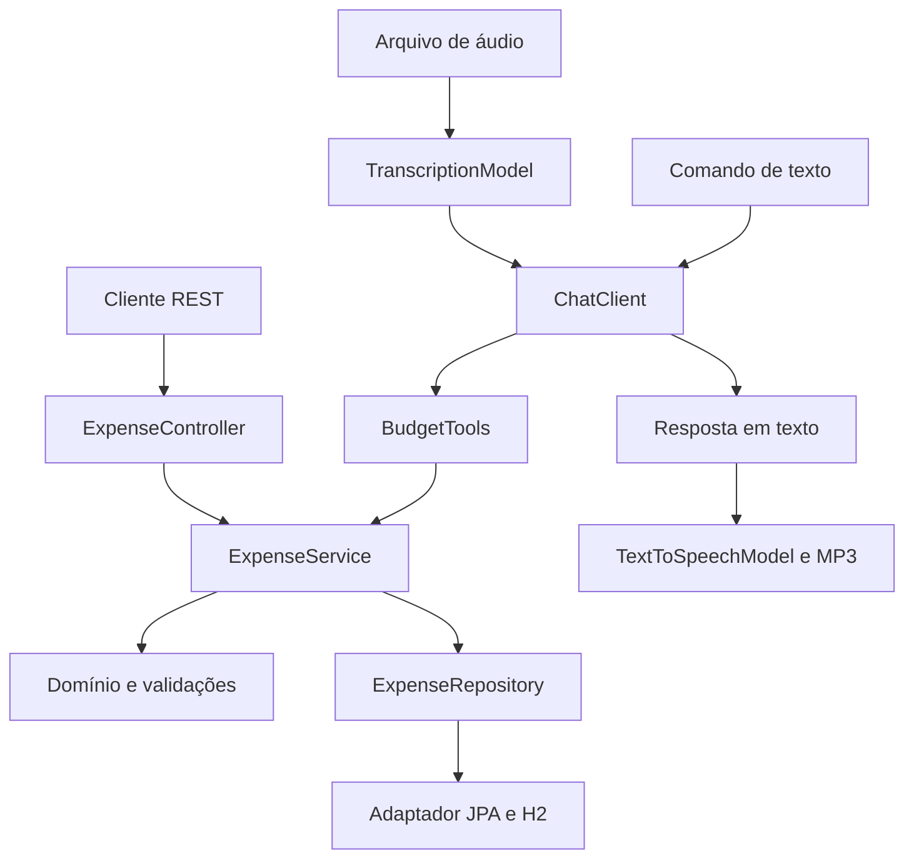

# BudgetAI — orçamento por texto e voz

API de despesas pessoais com **Spring Boot** e **Spring AI**. Recebe comandos em português por texto ou áudio, usa Tool Calling para executar funções reais e responde com texto ou voz gerada por IA.

Projeto educacional desenvolvido para o desafio da DIO **Desenvolvendo sua API Inteligente com Reconhecimento de Fala e Spring Boot**. A arquitetura e o fluxo foram inspirados no [módulo 05 da trilha oficial](https://github.com/digitalinnovationone/dio-spring-boot-learning-track/tree/main/05-spring-ai), com implementação própria e melhorias descritas abaixo.

## Painel visual local

Acesse **http://127.0.0.1:8080/** após iniciar a aplicação. A tela funciona sem chave de IA e inclui resumo por período, distribuição por categoria, busca na lista, filtros, cadastro de despesa e exportação CSV da lista filtrada.

A interface é HTML, CSS e JavaScript, servida pelo próprio Spring Boot, sem instalação de ferramentas de frontend e sem fontes ou bibliotecas externas. Foi desenvolvida com a skill Impeccable, na direção Caderno digital confirmada pelo usuário.

O total e a distribuição sempre representam todas as despesas do período; os filtros de categoria e busca afetam apenas a lista. A listagem tem limite de 200 itens, indicado quando atingido. Gastos fictícios de demonstração recebem um rótulo na interface.

## O que a API faz

- Registra despesas com descrição, valor em reais, categoria e data.
- Consulta despesas por período e, opcionalmente, por categoria.
- Calcula quantidade, total geral e totais por categoria.
- Transcreve um arquivo de áudio, interpreta o pedido e chama ferramentas da aplicação.
- Retorna a transcrição e a resposta em JSON ou gera uma resposta MP3.
- Persiste dados localmente com JPA e H2 em arquivo.

Esta versão trabalha com **despesas**; não movimenta contas bancárias nem registra receitas.

## Evolução implementada

A melhoria principal é o **resumo por período e categoria**, disponível tanto por REST como por Tool Calling. Os totais são calculados a partir dos registros no banco, sem delegar a aritmética ao modelo.

Outras melhorias:

- Valores monetários com `BigDecimal`, em reais, sem conversão implícita de centavos.
- Validações compartilhadas entre REST e ferramentas: descrição obrigatória, categoria e data obrigatórias, valor positivo com até duas casas decimais, limite de valor e rejeição de datas futuras.
- Períodos inclusivos de até 366 dias e tratamento de consultas sem resultados.
- Respostas de erro HTTP no formato `application/problem+json`, com diagnóstico de crédito/cota, autenticação, permissão e rede nas falhas de IA.
- Perfil local que funciona sem credenciais de IA, para estudar e testar persistência e regras.
- Bibliotecas nativas de DNS do Netty para macOS Apple Silicon e Intel.
- Separação entre controladores REST, integração de IA, serviço de aplicação, domínio e adaptador de persistência.
- Testes automatizados de domínio, HTTP com banco real em memória, ferramentas e orquestração de áudio com mocks.

## Tecnologias

| Tecnologia | Versão / uso |
| --- | --- |
| Java | 25 |
| Spring Boot | 4.0.5 |
| Spring AI | 2.0.0-M4 |
| Gradle Wrapper | 9.4.1 |
| Spring Data JPA / H2 | Persistência |
| Spring MVC / Actuator | REST e health check |
| JUnit 5 / AssertJ / Mockito | Testes |
| OpenAI | Chat, transcrição e síntese de voz no perfil `ai` |

As versões de Java, Boot e Spring AI acompanham a base consultada da trilha. Spring AI `2.0.0-M4` é uma versão milestone. O projeto é para aprendizado e execução local.

## Arquitetura



`domain` não depende de Spring. REST e IA usam o mesmo `ExpenseService`. O assistente só acessa as três ferramentas registradas: `createExpense`, `listExpenses` e `summarizeExpenses`.

## Como executar

Pré-requisitos: JDK 25 e conexão à internet no primeiro build para baixar o Gradle e as dependências. Não é necessário instalar Gradle separadamente ou iniciar Docker.

```bash
git clone https://github.com/matheus-2207/budgetai-spring.git
cd budgetai-spring
./gradlew bootRun
```

No Windows, use `gradlew.bat bootRun`. Se necessário no macOS/Linux: `chmod +x gradlew`.

A API escuta em `http://127.0.0.1:8080`. Sem perfil, endpoints de IA não são carregados. Os dados ficam em `./data/budgetai.mv.db` e sobrevivem à reinicialização. A pasta `data` está excluída do Git.

```bash
curl http://127.0.0.1:8080/actuator/health
```

### Ativar IA

Defina a chave apenas no seu terminal e ative o perfil:

```bash
export OPENAI_API_KEY='sua-chave'
./gradlew bootRun --args='--spring.profiles.active=ai'
```

O `.env.example` serve apenas como referência: Spring não carrega esse arquivo automaticamente. Também é possível configurar as variáveis de ambiente na IDE. Nunca publique a chave.

Os modelos padrão são `gpt-4o-mini`, `whisper-1` e `gpt-4o-mini-tts`, seguindo a proposta da base. O chat pode ser alterado com `OPENAI_CHAT_MODEL`. A chave precisa ter acesso aos modelos e disponibilidade para chamadas pagas; a assinatura do ChatGPT não substitui o acesso à API.

## Endpoints

| Método | Rota | Resposta |
| --- | --- | --- |
| POST | `/api/expenses` | Despesa criada, HTTP 201 |
| GET | `/api/expenses?from=...&to=...&category=...` | Lista de até 200 despesas |
| GET | `/api/expenses/summary?from=...&to=...` | Resumo de todas as despesas do período |
| POST | `/api/assistant/text` | Transcrição/comando e resposta JSON |
| POST | `/api/assistant/audio` | Transcrição do áudio e resposta JSON |
| POST | `/api/assistant/voice` | Resposta `audio/mpeg` |
| GET | `/actuator/health` | Estado da aplicação |

As três rotas `/api/assistant` exigem o perfil `ai`. Datas devem usar `AAAA-MM-DD`. Categorias: `GROCERIES`, `PHARMA`, `AUTO`, `FOOD`, `LEISURE` e `OTHER`.

## Testar o fluxo principal

### 1. Registrar uma despesa sem IA

```bash
curl -i -X POST http://127.0.0.1:8080/api/expenses \
  -H 'Content-Type: application/json' \
  -d '{"description":"Mercado","amount":35.90,"category":"GROCERIES","occurredOn":"2026-01-10"}'
```

A resposta 201 inclui `id`, descrição, `amount: 35.90`, categoria, data e `createdAt`. Os identificadores e instantes são gerados pela aplicação. O valor `35.90` significa R$ 35,90.

### 2. Consultar e resumir

```bash
curl 'http://127.0.0.1:8080/api/expenses?from=2026-01-01&to=2026-01-31&category=GROCERIES'
curl 'http://127.0.0.1:8080/api/expenses/summary?from=2026-01-01&to=2026-01-31'
```

Se o banco contiver apenas a despesa do exemplo, o resumo será:

```json
{
  "from": "2026-01-01",
  "to": "2026-01-31",
  "count": 1,
  "total": 35.90,
  "categories": [{"category": "GROCERIES", "count": 1, "total": 35.90}]
}
```

A listagem é limitada a 200 itens, ordenados por data e criação decrescentes. O resumo inclui **todos** os registros do período, mesmo que existam mais de 200. Cada chamada de criação gera um novo registro: repetir o exemplo altera o total.

### 3. Conferir uma validação

```bash
curl -i -X POST http://127.0.0.1:8080/api/expenses \
  -H 'Content-Type: application/json' \
  -d '{"description":"Inválida","amount":-10,"category":"FOOD","occurredOn":"2026-01-10"}'
```

Resultado esperado: HTTP 400, com descrição do erro, sem salvar a despesa. Datas futuras e valores com mais de duas casas decimais também são rejeitados.

### 4. Comando por texto com IA ativada

```bash
curl -X POST http://127.0.0.1:8080/api/assistant/text \
  -H 'Content-Type: application/json' \
  -d '{"message":"Registre um gasto de 22,50 reais com almoço em 10 de janeiro de 2026."}'
```

Depois, peça um resumo:

```bash
curl -X POST http://127.0.0.1:8080/api/assistant/text \
  -H 'Content-Type: application/json' \
  -d '{"message":"Quanto gastei de 1 a 31 de janeiro de 2026? Mostre por categoria."}'
```

A resposta possui `transcript` e `answer`. O texto exato depende do modelo; confira os registros pelo endpoint REST. Não há memória de conversa entre requisições, então cada mensagem deve conter o contexto necessário.

### 5. Comando por áudio

Grave, por exemplo: “Registre um gasto de 18 reais com almoço hoje”. Envie um arquivo real:

```bash
curl -X POST http://127.0.0.1:8080/api/assistant/audio \
  -F 'file=@comando.m4a'
```

Para receber voz, grave uma **consulta**, evitando repetir o registro anterior:

```bash
curl --fail-with-body -X POST http://127.0.0.1:8080/api/assistant/voice \
  -F 'file=@consulta.m4a' \
  -o resposta.mp3
```

A voz da resposta é gerada por IA. Formatos aceitos: mp3, mp4, mpeg, mpga, m4a, wav e webm, até 10 MB. A validação de extensão não verifica o conteúdo: o provedor ainda pode rejeitar áudio inválido. Cada uma das rotas de áudio executa o comando completo.

## Testes e evidências

```bash
./gradlew test
./gradlew bootJar
java -jar build/libs/budgetai-spring-1.0.0.jar
```

Os testes não precisam de chave e não fazem chamadas pagas. Verificam precisão monetária, validações, gravação via HTTP, agrupamentos no H2, geração de schemas das ferramentas e sequência transcrição → chat → voz com mocks.

Veja [evidências de verificação](docs/VERIFICACAO.md) e [requisições de exemplo](docs/requests.http). O relatório local é gerado em `build/reports/tests/test/index.html`.

**Limite da verificação:** o fluxo com o provedor real depende de chave e saldo de API. Os testes com mocks comprovam a orquestração interna; não comprovam disponibilidade dos modelos, qualidade de transcrição ou decisão de Tool Calling em uma chamada real.

## Decisões e limites

- Aplicação local de um único usuário; não há autenticação nem isolamento de contas. A escuta padrão é `127.0.0.1`.
- Banco H2 em arquivo para simplificar o estudo; `ddl-auto=update` não substitui migrações em produção.
- Sem idempotência: repetir uma criação pode duplicá-la. Se a IA falhar depois de salvar, uma resposta 502 orienta consultar as despesas antes de tentar novamente. Não há transação única envolvendo banco e provedor externo.
- `createdAt` registra a criação, mas não representa uma trilha completa de auditoria de comandos ou alterações.
- A IA pode interpretar um comando incorretamente. O prompt solicita esclarecimento para ambiguidades e o domínio rejeita dados inválidos; revise os registros antes de usar para qualquer decisão real.

## Aprendizados trabalhados

- Conectar capacidades de IA a funções reais com `ChatClient` e `@Tool`.
- Compartilhar regras entre interfaces REST e IA, preservando o domínio.
- Representar dinheiro com precisão decimal e validar antes de persistir.
- Separar testes determinísticos de testes que dependem de um provedor externo.
- Documentar tanto o fluxo de uso quanto os limites da implementação.

## Referências e créditos

- [Trilha Spring Boot da DIO](https://github.com/digitalinnovationone/dio-spring-boot-learning-track).
- [Projeto de referência Spring AI](https://github.com/digitalinnovationone/dio-spring-boot-learning-track/tree/main/05-spring-ai), consultado no commit `9add4345f9f0f75e1a02dcd557c627fdf6187ff7`. O Gradle Wrapper foi reutilizado da trilha, mantendo seus cabeçalhos.
- [Spring AI — Tool Calling](https://docs.spring.io/spring-ai/reference/api/tools.html).
- [Spring AI — Transcrição](https://docs.spring.io/spring-ai/reference/api/audio/transcriptions.html).
- [Spring AI — Síntese de voz](https://docs.spring.io/spring-ai/reference/api/audio/speech.html).
- [OpenAI — Áudio e voz](https://developers.openai.com/api/docs/guides/text-to-speech).
